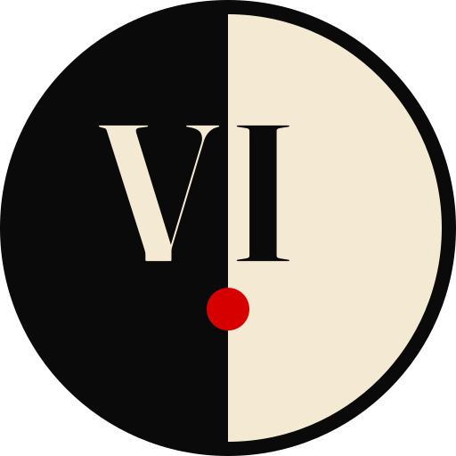
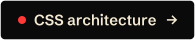

<a id="top"></a>

<div align="center">

<picture>
  <source media="(prefers-color-scheme: dark)" srcset="https://raw.githubusercontent.com/voaneves/voaneves-intermediario/main/assets/logo/logo-dark.svg" />
  <source media="(prefers-color-scheme: light)" srcset="https://raw.githubusercontent.com/voaneves/voaneves-intermediario/main/assets/logo/logo-light.svg" />
  
</picture>

<h1>voaneves-intermediario</h1>

<p>
  <strong>Staging copy of the portfolio site, built from SASS partials with a Node build script.</strong><br />
  <sub>Static HTML, CSS and JavaScript, with styles compiled from SASS</sub>
</p>

<p>
  <a href="#2-css-architecture"><picture><source media="(prefers-color-scheme: dark)" srcset="https://raw.githubusercontent.com/voaneves/voaneves-intermediario/main/assets/buttons/css-dark.svg" /></picture></a>
  <a href="#25-build-commands"><picture><source media="(prefers-color-scheme: dark)" srcset="https://raw.githubusercontent.com/voaneves/voaneves-intermediario/main/assets/buttons/build-dark.svg" /></picture></a>
</p>

<p><sub>Need something like this? <a href="https://voaneves.com/en/#contact"><strong>Let's talk →</strong></a></sub></p>

<p>
  <a href="https://github.com/voaneves/voaneves-intermediario/blob/main/LICENSE"></a>
  
</p>

<p>
  <a href="#1-getting-started">Getting started</a> ·
  <a href="#2-css-architecture">CSS architecture</a> ·
  <a href="#25-build-commands">Build commands</a> ·
  <a href="#contact">Contact</a>
</p>

</div>

<picture>
  <source media="(prefers-color-scheme: dark)" srcset="https://raw.githubusercontent.com/voaneves/voaneves-intermediario/main/assets/brand/rule-dark.svg" />
  <source media="(prefers-color-scheme: light)" srcset="https://raw.githubusercontent.com/voaneves/voaneves-intermediario/main/assets/brand/rule-light.svg" />
  
</picture>

## 1. Getting Started

A staging copy of Victor Neves's portfolio website, used to try changes (a SASS-based stylesheet pipeline and a Node build script) before they reach the main site. It is not published as a landing page.

### 1.1. Technology Used

HTML, CSS, JavaScript and SASS.

### 1.2. Progressive Web App

The site is a PWA: installable and usable offline.

### 1.3. Site optimization

Built with SEO and accessibility in mind. Google Analytics was removed on purpose because of the performance cost.

### 1.4. Dark and light themes

Dark and light themes on desktop, tablet and mobile.

### 1.5. English version

The site also has a fully translated English version.

## 2. CSS Architecture

The stylesheet pipeline was unified in a six-phase migration: the old setup loaded two CSS files in series (`styles.css` + `playful.css`, ~136 KB ungzipped) with two parallel naming conventions colliding in the cascade. Now it compiles a single `styles.css` (~81 KB ungzipped, ~15 KB gzipped) from 32 SCSS partials. Sass modules use the modern `@use` / `@forward` syntax — `@import` is fully eliminated.

### 2.1. Partial structure

Partials in `assets/styles/` are grouped by role. Load order (defined in `styles.scss`) is significant — it controls cascade precedence:

```
Foundation
  _include.scss         mixins, fluid() function, $breakpoints map
  _tokens.scss          design tokens (--ink, --cream, --signal, --pad-*, legacy --color-*)
  _theme.scss           three-tier theme resolution (defaults / system / user toggle)

Shared utilities (legacy)
  _header.scss          universal * reset + fluid type scale (--text-*) + base body/section/a
  _sidebar.scss
  _cursor.scss          legacy #cursor + v4 .pf-cur/.pf-ring system
  _independent-components.scss
  _scrollbar.scss
  _scroll-icon.scss
  _social-icons.scss    icomoon font binding
  _toast.scss
  _dropdown.scss
  _animations.scss      @keyframes + gravity/spring entrance + party-mode
  _selection.scss       ::selection + ::-moz-selection

Legacy inline blocks (transitional)
  _legacy-inline.scss   what remained from styles.scss inline body after cleanup

v4 design (extracted from playful.css during Fase 2)
  _reset.scss           .v4 body resets + section min-height + skip-link
  _ripple.scss          .pf-ripple / .pf-word / .pf-scroll-bar utilities
  _nav.scss             top navigation + utility buttons + CTA
  _drawer.scss          mobile slide-in drawer
  _hero.scss            hero section (largest partial — name + photo + aurora + chips)
  _intro.scss           editorial statement section
  _stats.scss           number cards with data-hue color variants
  _expertise.scss       stacked marquees
  _timeline.scss        horizontal drag-scroll cards
  _portfolio.scss       project list with cursor image preview
  _services.scss        bento grid + accordion
  _contact.scss         massive statement on red bg + glitch email + icons
  _footer.scss          row + outline-text multilingual marquee
  _legacy.scss          visual easter eggs (.mesh-rings) — kept until next audit
  _theme-overrides.scss section conversions + per-mode hardening — loaded LAST
```

### 2.2. BEM convention

Class names follow loose BEM:

- `.block` — a self-contained component (e.g. `.hero`, `.timeline`, `.cta`)
- `.block__element` — a part of the block (e.g. `.hero__photo`, `.timeline__card-meta`)
- `.block--modifier` — a variant (e.g. `.cta--pill`, `.hero__line--right`, `.hero__aurora-blob--orange`)

There is no `v4-` or version prefix anywhere — that was the cleanup in Fase 3. Section names describe what the element is (`.hero`, not `.v4-hero` or `.header-content`).

JavaScript state flags use `is-*` and are added/removed dynamically — they are NOT renamed by the BEM convention: `is-active`, `is-hover`, `is-on-photo`, `is-revealed`, `is-open`, `is-toggling`, `is-dragging`.

### 2.3. Design tokens

All tokens live in `_tokens.scss`. Two token families coexist:

```scss
/* v4 — consumed by every modern partial */
--ink          /* primary text / dark surface          */
--ink-soft     /* raised dark surface                  */
--cream        /* primary bg / light text on dark      */
--cream-soft   /* secondary bg                         */
--signal       /* brand red (CTA, accents)             */
--signal-2     /* hot accent (hover, indicators)       */
--hue-orange   /* decorative — stats, hero aurora      */
--hue-pink
--hue-blue
--hue-yellow
--maroon
--line         /* hairlines on light surfaces          */
--line-on-dark
--pad-x        /* clamp(20px, 4vw, 64px) section gutter */
--pad-y        /* clamp(60px, 10vh, 140px) vertical pad */

/* Legacy — for the parts that haven't been migrated yet */
--color-primary    /* legacy background  — follows --cream  */
--color-secondary  /* aliased to var(--signal)              */
--color-white      /* legacy text color                     */
--color-white-2 / --color-black / --color-grey-{0..6} / --color-opposite / --color-yellow
```

Theme overrides for both families live in `_theme.scss` and `_tokens.scss`.

### 2.4. Theme system

A three-tier resolution decides which palette wins:

1. **`:root` defaults** (`_tokens.scss`) — tuned for a light environment / no system preference.
2. **`@media (prefers-color-scheme: dark) :root`** (`_theme.scss`) — automatic when the OS is in dark mode.
3. **`.light-mode` / `.dark-mode`** on `<body>` (`_theme.scss`) — explicit user override via the toggle button. Beats the system preference by specificity.

Section-level routing is data-attribute driven: `<section class="hero" data-section-bg="ink">` flags this section as dark-surface. Theme rules in `_theme-overrides.scss` consume that attribute to convert surfaces between themes (e.g., a `cream` section becomes `ink-soft` when system is dark, then stays `cream` when the user toggles light).

Rules inside `@media (prefers-color-scheme: dark)` use `.v4:not(.light-mode)` qualifier so that an explicit light toggle on a dark OS correctly suppresses the system-dark rules. Mirror logic with `:root:not(.dark-mode)` covers the inverse.

### 2.5. Build commands

Compile the production stylesheet:

```bash
npx sass assets/styles/styles.scss assets/styles/styles.css \
  --style=compressed --source-map --no-charset
```

Flags rationale:
- `--style=compressed` — minified output.
- `--source-map` — for debugging in DevTools.
- `--no-charset` — prevents Sass from prepending a BOM when non-ASCII chars (em-dashes in comments) trigger its UTF-8 detection.

For an ongoing dev session use `--watch` instead of one-shot compilation:

```bash
npx sass assets/styles/styles.scss assets/styles/styles.css --watch --no-charset
```

The pipeline produces zero deprecation warnings against Dart Sass 1.69+. `darken()` / `lighten()` migrated to `color.scale()`, `/` arithmetic migrated to `math.div()`, and `map-*` helpers migrated to the namespaced `map.*` module (with a few stragglers still pending in `respond-from` / `respond-between`).

### 2.6. Adding a new section

1. Create the partial: `assets/styles/_my-section.scss`.
2. If the partial uses mixins/functions from `_include.scss`, declare the dependency at the top: `@use "include" as *;`. CSS-only partials need no `@use`.
3. Wire it into `styles.scss` near the other section partials, AFTER `_legacy-inline.scss` so the new BEM rules win the cascade where they overlap with legacy: `@use "my-section";`.
4. In `index.html` add the markup: `<section class="my-section" id="my-section" data-section-bg="cream">…</section>`. Choose the surface (`ink`, `cream`, or `red`) via `data-section-bg`.
5. Inside the partial set `display: flex; flex-direction: column; justify-content: center` if you want the immersive 100vh-centered content feel (see existing sections for reference).
6. Theme-specific overrides (light / dark / system) go in `_theme-overrides.scss`, not in the section partial itself. That keeps the section file focused on layout + base color.

### 2.7. Adding a new token

1. Add the token to the `:root { … }` block in `_tokens.scss`. Comment its purpose and the AA/AAA contrast budget if relevant.
2. If the token is theme-dependent, add the swap in `_theme.scss`:
   - `@media (prefers-color-scheme: dark) :root { --my-token: …; }` for system dark.
   - `.light-mode { --my-token: …; }` and `.dark-mode { --my-token: …; }` for explicit user toggle.
3. Reference it via `var(--my-token)` from any partial — no `@use` needed for custom properties, they cascade through the document.

## 3. Contributing

Send a pull request or open an issue. See the [contributing guide](https://gist.github.com/PurpleBooth/b24679402957c63ec426) for the code of conduct and the pull request process.

## 4. License

This project is licensed under the MIT License. See the [LICENSE](https://github.com/voaneves/voaneves-intermediario/blob/main/LICENSE) file for details.

## 5. Acknowledgments

- @Maclinz, for the [JS_CSS_PortfolioProject](https://github.com/Maclinz/JS_CSS_PortfolioProject) tutorial.
- [web.dev](https://web.dev), for the tutorials and guidance.

## Contact

<p>
  <a href="https://voaneves.com/en/#contact"><picture><source media="(prefers-color-scheme: dark)" srcset="https://raw.githubusercontent.com/voaneves/voaneves-intermediario/main/assets/buttons/hire-dark.svg" /></picture></a>
  <a href="https://voaneves.com/en/"><picture><source media="(prefers-color-scheme: dark)" srcset="https://raw.githubusercontent.com/voaneves/voaneves-intermediario/main/assets/buttons/site-dark.svg" /></picture></a>
</p>

<a href="https://linkedin.com/in/voaneves">LinkedIn</a> · <a href="mailto:victorneves478@gmail.com">E-mail</a>

<p align="center">
  
</p>

<p align="center"><sub>Released under the <a href="https://github.com/voaneves/voaneves-intermediario/blob/main/LICENSE">MIT License</a>.</sub></p>

<p align="center"><sub><a href="#top">↑ Back to top</a></sub></p>
